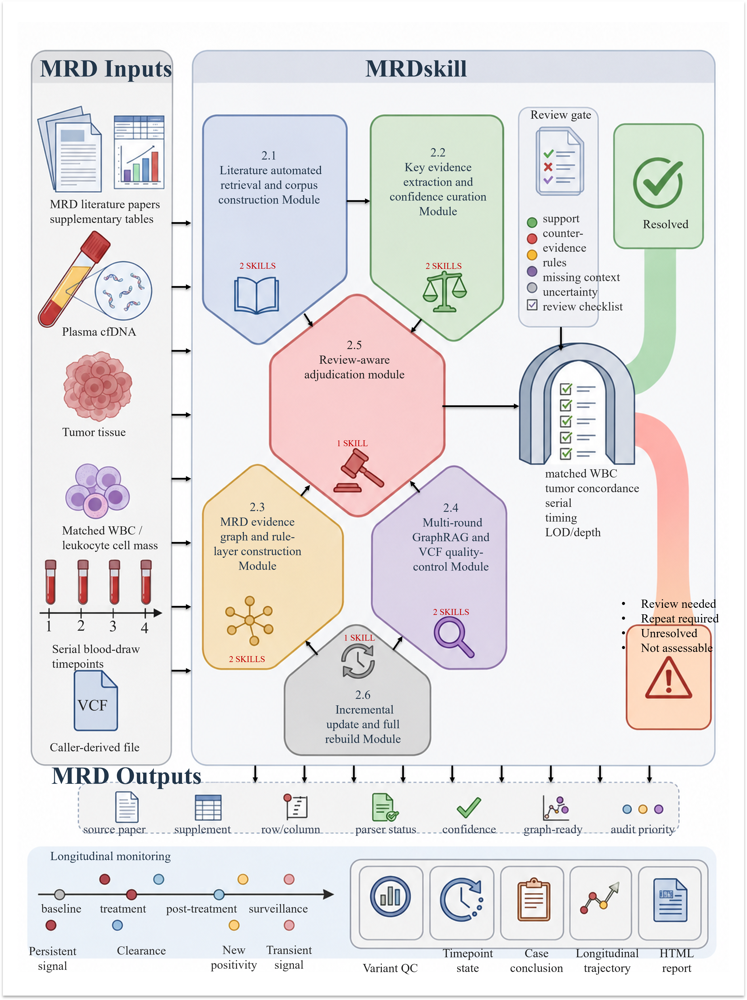
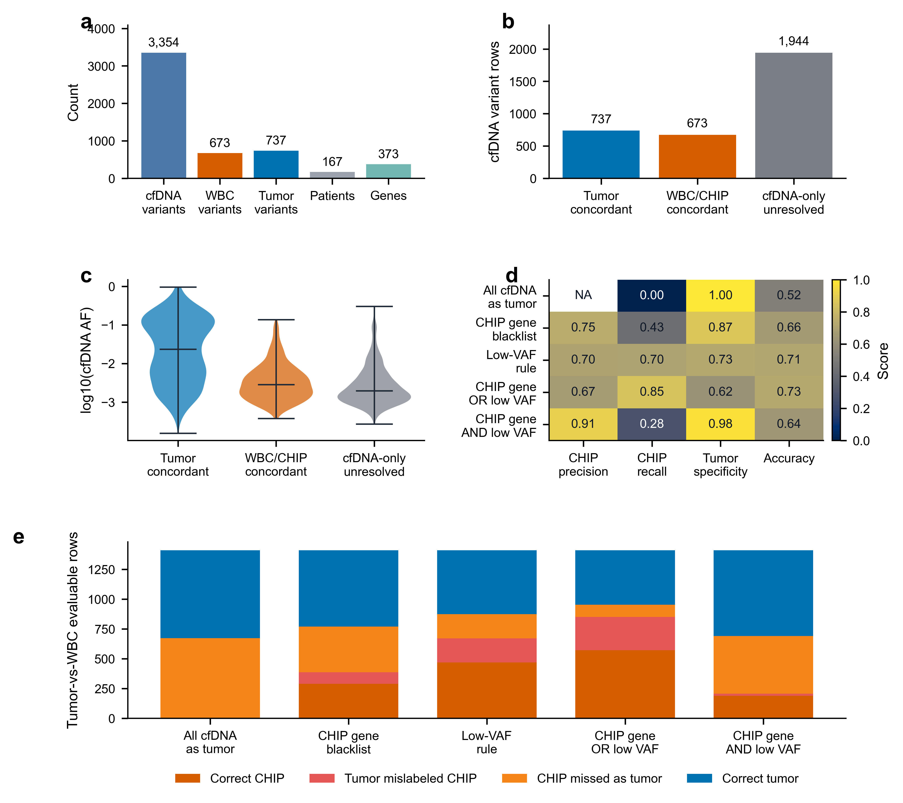
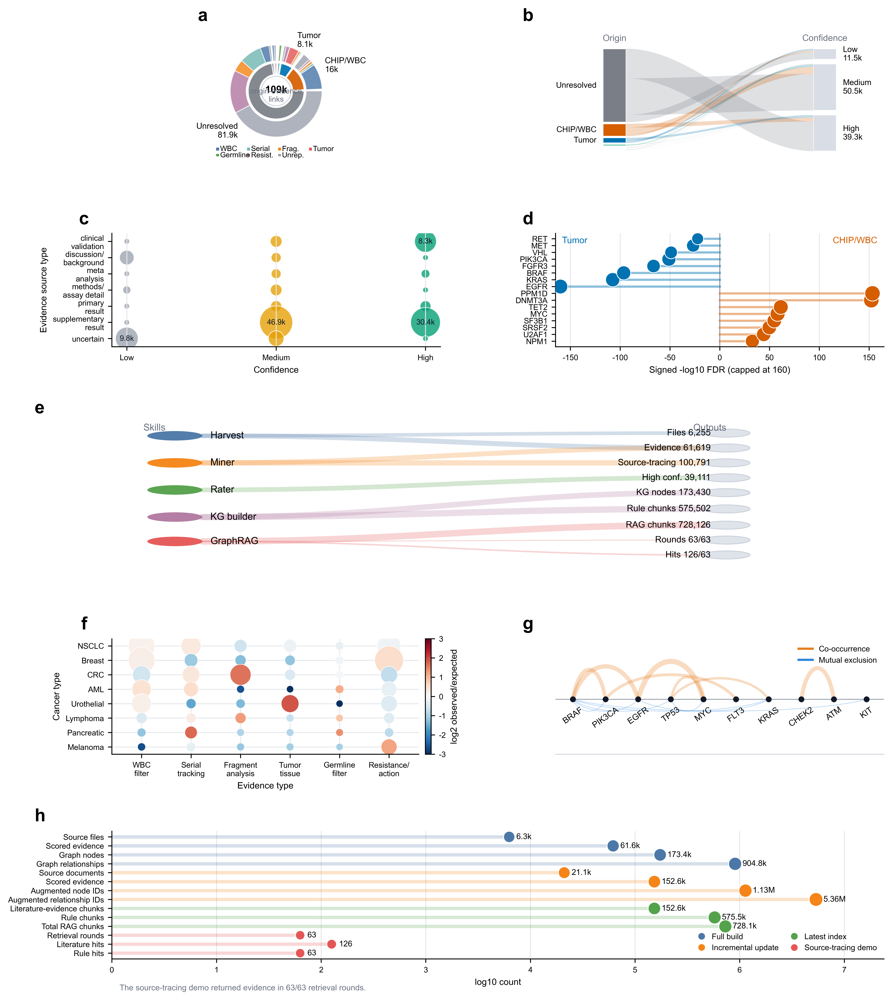
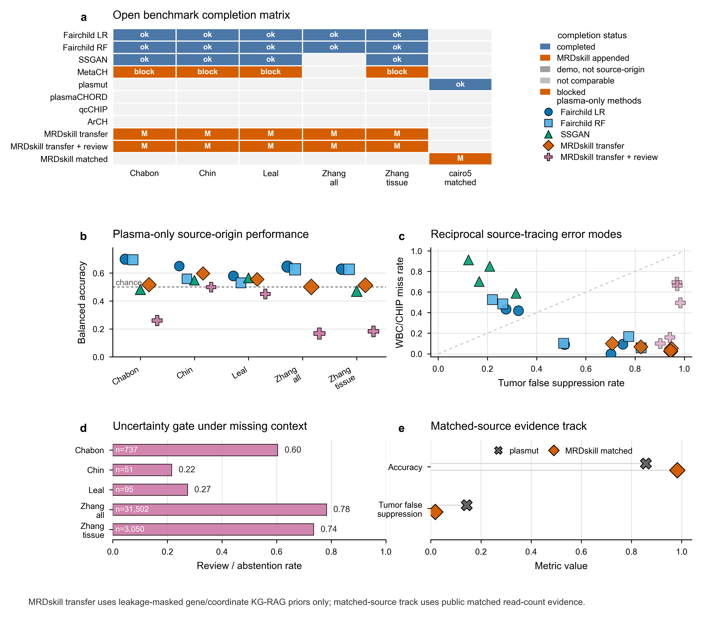
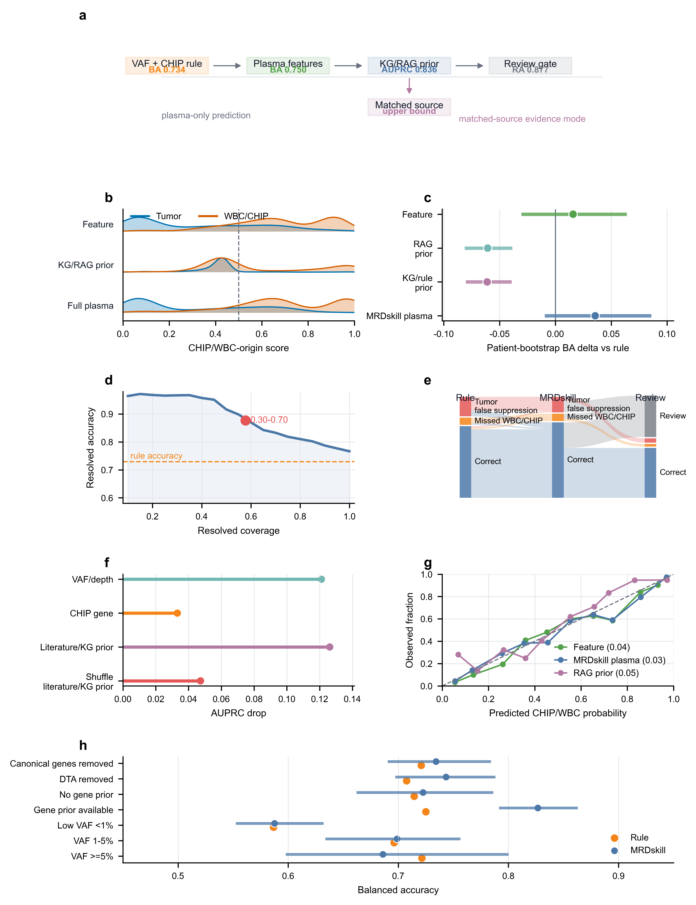
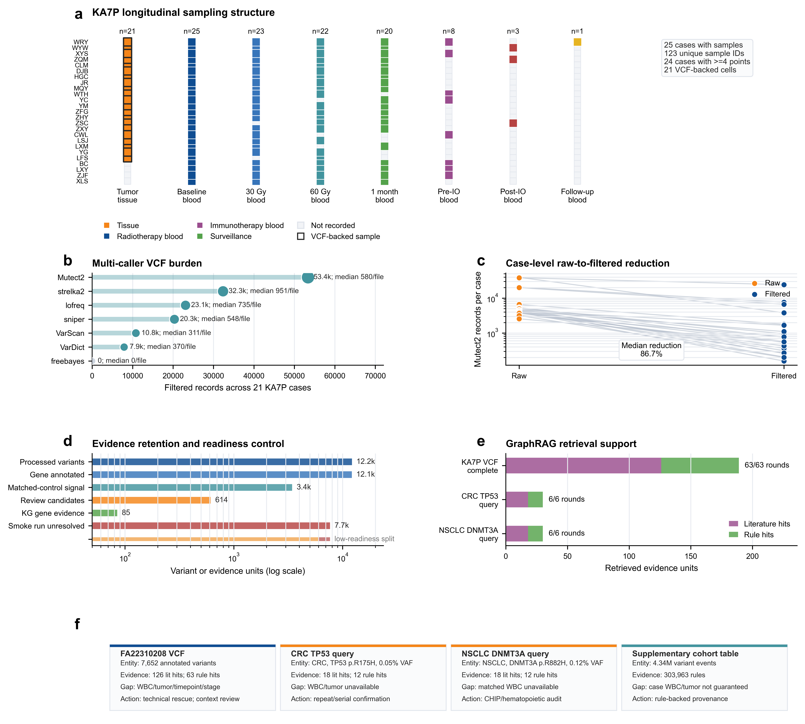
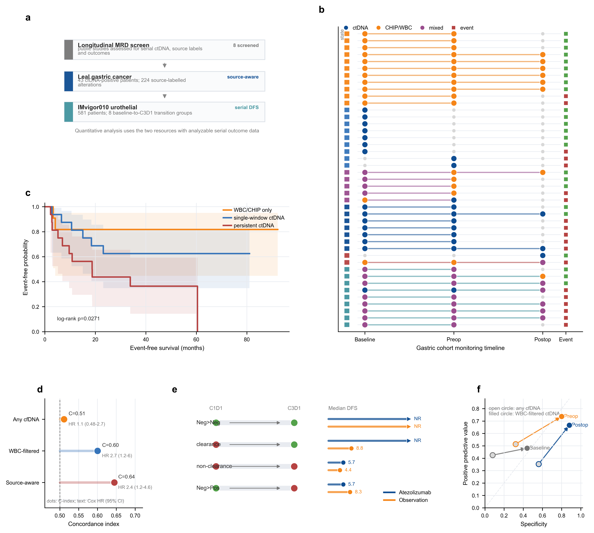

# MRDskill

MRDskill is a provenance-first Agent-Skill system for auditable cfDNA-MRD source tracing, review-aware quality control, and longitudinal monitoring.

The source package implements the ten operational skills defined in the manuscript supplement. Their module mapping, QC boundaries, and executable entrypoints are maintained in [`skills/registry.csv`](skills/registry.csv). [`skills/implementation_map.csv`](skills/implementation_map.csv) assigns every implementation source to one of those skills or to shared launch infrastructure.

## Workflow Overview

<p align="center">
  
</p>

## Install

```powershell
python -m venv .venv
.\.venv\Scripts\Activate.ps1
python -m pip install --upgrade pip
python -m pip install -r requirements.txt
```

By default, generated data is written beneath `artifacts/`. Set `MRDSKILL_ARTIFACT_ROOT` to keep large runtime artifacts elsewhere.

The optional `opendataloader-pdf` CLI enables layout-aware PDF conversion. The bundled `pdfminer` converter remains available when that CLI is not installed.

## Offline KG + RAG Demo

Run the complete software path on a tiny, synthetic fixture without downloading papers or benchmark data:

```powershell
python .\scripts\run_demo.py
python .\scripts\run_demo.py --output-dir .\artifacts\demo --verify-expected
```

On Windows, `scripts\run_demo.ps1` is a shortcut. The runner uses the repository's KG builder, unified RAG index builder, seven-round source-tracing retrieval, and interactive KG visualizer. It needs Python 3.10+ and only the standard library. The generated KG preview is `artifacts/demo/kg_demo.html`; precomputed outputs and checksums are under [`examples/expected/`](examples/expected/). The fixture is synthetic, CC0-1.0, contains no patient data or external literature, and is not biological evidence, benchmark data, or for clinical use. See [`docs/reproducibility.md`](docs/reproducibility.md) for scope and the full-data workflow.

The aggregate dashboard [`docs/full_kg_overview.html`](docs/full_kg_overview.html) shows counts and distributions from a complete local KG/RAG build. It is a static aggregate snapshot only: the underlying graph, evidence rows, and RAG corpus are not included in this repository.

## Operational Skills

| Manuscript Table 1 term | Skill | Primary entrypoint |
| --- | --- | --- |
| Paper search | `paper-search` | `skills/paper-search/scripts/search.py` |
| Literature harvest | `literature-harvest` | `skills/literature-harvest/scripts/harvest.py` |
| Evidence miner | `mrd-evidence-miner` | `skills/mrd-evidence-miner/scripts/mrdskill_extract_full_corpus_evidence.py` |
| Confidence rater | `mrd-confidence-rater` | `skills/mrd-confidence-rater/scripts/mrdskill_score_mrd_evidence.py` |
| KG builder | `mrd-kg-builder` | `skills/mrd-kg-builder/scripts/mrdskill_build_mrd_kg_csv.py` |
| Supplemental rule | `supplementary-rule` | `skills/supplementary-rule/scripts/build_rules.py` |
| GraphRAG | `mrd-graphrag` | `skills/mrd-graphrag/scripts/query.py` |
| VCF QC | `mrd-vcf-qc` | `skills/mrd-vcf-qc/scripts/run_qc.py` |
| Review-aware adjudication | `review-aware-adjudication` | `skills/review-aware-adjudication/scripts/run_adjudication.py` |
| Update/audit | `mrd-update-audit` | `skills/mrd-update-audit/scripts/update.py` |

Run `python tools/validate_skill_coverage.py` to verify that the release still has exactly ten skills and that every implementation source is assigned. Experiment and figure scripts are marked `reproducibility` in the implementation map; they remain part of their owning skill and do not create an eleventh runtime skill.

## Result Figures

| Figure 2 | Figure 3 |
| --- | --- |
|  |  |

| Figure 4 | Figure 5 |
| --- | --- |
|  |  |

| Figure 6 | Figure 7 |
| --- | --- |
|  |  |

## Example: Literature Search Then Harvest

```powershell
python .\skills\paper-search\scripts\search.py `
  --output-root ".\artifacts\runs" `
  --config ".\config\literature_harvest_config.template.json" `
  --run-name "mrd_2016_2026"

python .\skills\literature-harvest\scripts\harvest.py `
  --output-root ".\artifacts\runs" `
  --config ".\config\literature_harvest_config.template.json" `
  --run-name "mrd_2016_2026"
```

Use `continue_harvest.py` to retry and deduplicate. It writes `papers_manifest.csv` and `supplements_manifest.csv` within the run directory.

## Data and Clinical Boundary

This repository contains code and templates plus the clearly labeled synthetic software fixture. It does not redistribute papers, supplements, patient data, VCFs, full graph exports, benchmark cohorts, or the full RAG index. Downloaded content remains subject to its original license and access conditions. MRDskill reports are review-support artifacts and do not replace clinical sign-out. See [`docs/data_availability.md`](docs/data_availability.md) for expected external inputs.

## Versioned Archive / DOI

No versioned Zenodo DOI is currently claimed. Maintainers can follow [`docs/zenodo-release-checklist.md`](docs/zenodo-release-checklist.md) to review metadata, create a versioned release, enable Zenodo archiving, and add the DOI actually minted for that release. Do not cite a DOI until Zenodo has created the archive.

## License

The source code is released under the [MIT License](LICENSE). Third-party literature, supplementary material, and external datasets are not covered by this license.
